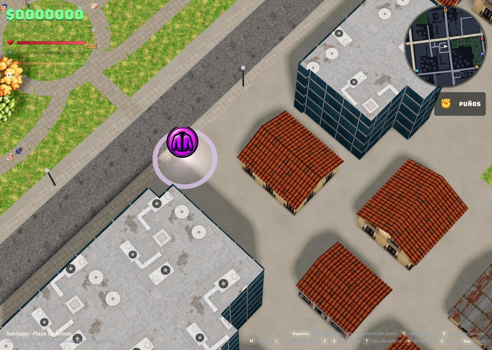
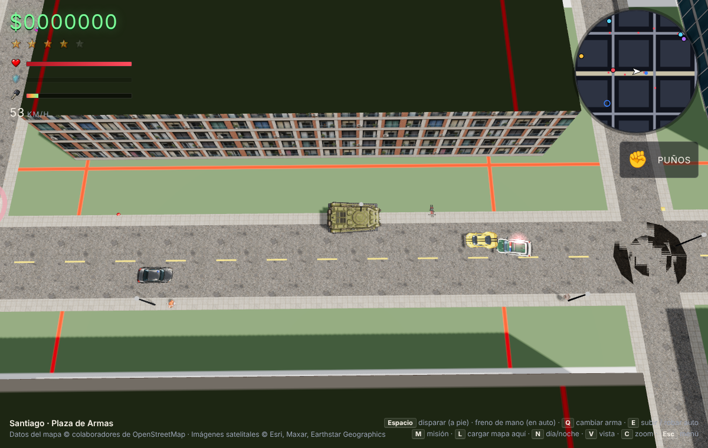

# Map Theft Auto

Un juego de mundo abierto con vista desde arriba, al estilo de **GTA 2**, que se juega en **cualquier ciudad real del mundo**. Las calles, los edificios, los parques y el agua se descargan en vivo desde OpenStreetMap y se arman en 3D en el navegador.

**Estado: en pausa.** Es un prototipo jugable. El código es abierto (licencia MIT): tómalo, modifícalo y llévalo donde quieras.

## Cómo jugar

- **En línea:** https://mariogacitua.github.io/map-theft-auto/
- **En tu computador:** descarga el repositorio y abre `jugar.command` (Mac) o sirve la carpeta con cualquier servidor web (`python3 -m http.server`) y entra a `http://localhost:8000`. Abrir `index.html` directo desde el disco no carga las imágenes.

Escribe una ciudad o dirección en el menú, o elige una partida rápida (Santiago, Valparaíso, Buenos Aires, CDMX, Nueva York, Tokio, Londres, París, Barcelona).

| Tecla | Acción |
|---|---|
| W A S D / flechas | Caminar o manejar (según la pantalla) |
| Espacio | Disparar a pie · freno de mano en auto · cañón en el tanque |
| Q | Cambiar arma |
| E | Subir, bajar o robar un auto |
| Shift | Correr |
| M | Pedir una misión de entrega |
| L | Descargar el mapa donde estás (para seguir explorando) |
| Z / X | Girar la vista 90° |
| T | Control según pantalla o clásico GTA 2 |
| N | Día / noche |
| C | Zoom |
| Esc | Menú |

## Qué tiene

- **Ciudades reales:** calles con su sentido y número de pistas, edificios con su altura y forma, parques, agua, plazas y estacionamientos de OpenStreetMap. Los lotes vacíos frente a las calles se rellenan con casas generadas con techo a dos aguas.
- **Texturas según el edificio:** el tipo, el material, el techo y el color que registra OpenStreetMap eligen la fachada (oficinas, colonial, departamentos, ladrillo) y el techo (tejas, zinc o plano con equipos). De noche se encienden las ventanas reales de cada fachada.
- **Vida en la calle:** tráfico que sigue la red de calles, peatones en las veredas, micros, ambulancias y bomberos.
- **Juego estilo GTA:** robar autos, misiones de entrega contra el tiempo, armas (bate, pistola, uzi, escopeta, rifle, lanzacohetes), vida y chaleco, nivel de búsqueda de 1 a 5 estrellas con patrullas que siguen las calles, policías a pie que arrestan, helicóptero, barricadas con miguelitos y un tanque con 5 estrellas.
- **Lugares:** talleres (reparan y borran estrellas), hospital, tienda de ropa y armería. Objetos para recoger por la ciudad.
- **Dos personajes** con animación de caminata, tres tenidas cada uno.

## Cómo está hecho

- Un solo archivo, `index.html`, con [Three.js](https://threejs.org) r147. Sin compilación ni dependencias locales.
- Datos de mapa: [Overpass API](https://overpass-api.de) (OpenStreetMap). Búsqueda de lugares: Nominatim y Photon.
- Cada carga trae un cuadrado de unos 1,1 km alrededor del punto elegido. Los edificios se extruyen a una altura "estilo GTA 2" (los altos se comprimen) y la cámara es casi cenital.
- Las imágenes de `assets/` se generaron con ChatGPT. El juego recorta automáticamente cada sprite a su dibujo y lo escala a su tamaño real (una persona ≈ 1,5 m, un auto ≈ 4,4 m). Si falta una imagen, el juego usa gráficos básicos en su lugar.
- Se probó también un modo con foto satelital (Esri World Imagery); quedó desactivado.

## Ideas pendientes

- Radios con música en los autos.
- Más misiones y una historia.
- Optimizar ciudades muy densas (Nueva York, Tokio).
- Sonido: motores, sirenas, disparos.

## Créditos y avisos

- Datos de mapa © colaboradores de OpenStreetMap, licencia ODbL.
- "Map Theft Auto" es una parodia sin relación con Rockstar Games ni con Grand Theft Auto. Si lo publicas o vendes, conviene cambiarle el nombre.
- Idea y dirección: Mario — D3LAHZ ([@mariogacitua](https://github.com/mariogacitua)). Código escrito con Claude.
